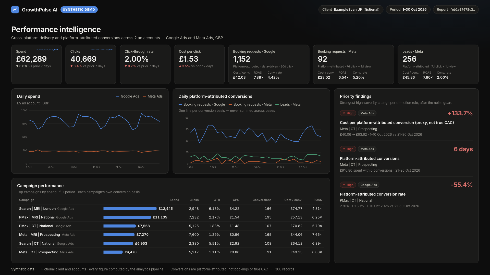
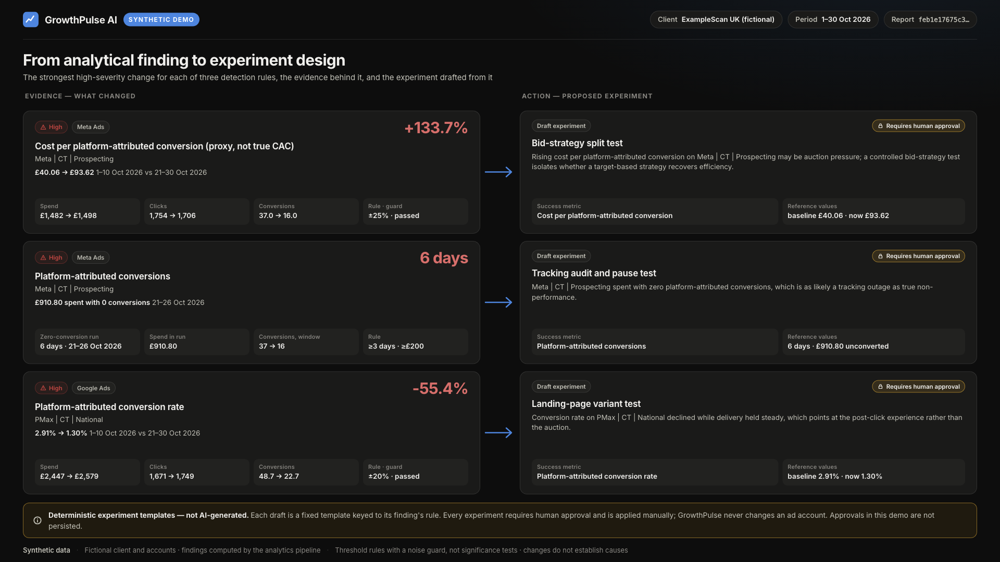
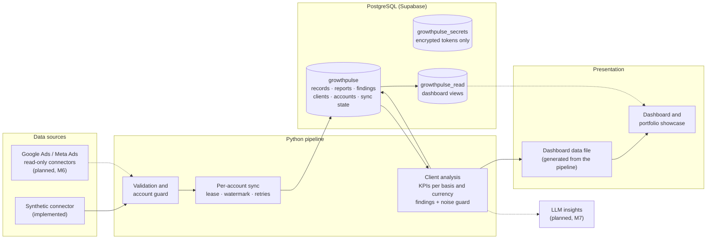

# GrowthPulse AI

**Multi-client performance-marketing intelligence for Google Ads and Meta Ads.** GrowthPulse normalises ad-platform data, calculates KPIs without mixing incompatible metrics, detects meaningful changes with a noise guard, and turns them into human-approved experiment drafts.

> **Portfolio project, synthetic data only.** Every client, account and figure here is fictional and generated deterministically. Nothing connects to a live advertising account. The analytics are deterministic and rule-based: **LLM-generated insights are planned, not implemented.** See [what's implemented and what's planned](#implemented-versus-planned).





*Both screenshots are rendered from the pipeline's own output with `node frontend/tools/export_showcase.mjs`.*

---

## The problem

Agencies and in-house teams running paid media for several brands face the same failure modes again and again:

- **Metrics added up across incompatible definitions.** Google's data-driven conversions get summed with Meta's 7-day-click-plus-1-day-view conversions, or spend gets added across currencies.
- **Noise read as signal.** A 40% jump on a handful of conversions triggers a budget change.
- **Platform-attributed conversions treated as real bookings,** and cost per conversion presented as true customer acquisition cost.
- **Changes applied straight from a dashboard,** with no hypothesis, no success metric and no approval trail.
- **Client data leaking between accounts** when one tool serves many brands.

GrowthPulse is built around those risks: explicit conversion bases, per-currency portfolios, a noise guard on every finding, stated limitations on every report, client isolation enforced by the database, and a human-approval requirement on every experiment.

## What it does today

| Area | Implemented |
|---|---|
| **Data model** | One normalised record per campaign, day, conversion definition and attribution setting, with a stable SHA-256 identity. Validation quarantines bad rows, and issue messages never contain values |
| **Synthetic connector** | A deterministic generator for three fictional clients, seven ad accounts, three currencies and three timezones, with planted scenarios (cost spikes, conversion-rate decline, a zero-conversion tracking outage) |
| **KPIs** | Spend, clicks, CTR, CPC. Conversions, conversion rate, cost per conversion and ROAS **per conversion basis**. Delivery deduplicated per campaign-day, and totals never summed across currencies |
| **Findings** | Six threshold rules over two comparison windows. A noise guard downgrades or suppresses changes resting on too few conversions. Findings are grouped and checked for persistence, and every finding carries its evidence and limitations |
| **Reports** | Deterministic JSON. The report ID is the SHA-256 of its body, so the same data always gives the same report (`feb1e176…` for the sample client) |
| **Multi-client architecture** | Clients, ad accounts, provider connections, per-account sync state, leases, retries and watermarks. Account syncs and client analysis run independently. Data quality is deduplicated across overlapping syncs |
| **Persistence** | PostgreSQL schema with least-privilege roles, row-level security, composite foreign keys for client and account isolation, append-only history, and a fail-closed backfill with a tested revert |
| **Credential foundations** | AES-256-GCM token encryption with versioned keys, and OAuth interfaces tested with fakes. **No real tokens exist** |
| **Dashboard** | Four screens: Performance Overview, AI Insights & Experiments, Accounts & Sync, and Reports. Plain HTML, CSS and JavaScript, light and dark modes, keyboard-accessible charts with table views |
| **Experiment workflow (demo)** | Deterministic templates derived from findings: draft, then proposed, then approved, in page state only. **Not AI-generated, not persisted, never applied to an ad account** |

## Architecture



Solid lines are implemented, dashed lines are planned. Four database roles keep the paths apart:
- **writer:** used by the pipeline;
- **dashboard:** reads views only;
- **manager:** runs owner actions only;
- **token manager:** handles encrypted tokens only.

Neither the writer nor the dashboard can reach tokens or owner actions.

## Data integrity safeguards

- **Attribution.** Conversions are only ever compared and totalled within one *conversion basis*: platform, conversion event, funnel stage and attribution window. Google's data-driven booking requests and Meta's 7-day-click-plus-1-day-view leads are shown separately and never summed.
- **Currency.** Each currency is its own portfolio, and no total crosses currencies. A client with GBP, EUR and USD accounts shows three portfolios.
- **Honest labels.** Conversions are labelled *platform-attributed*. Cost per conversion is labelled *a proxy, not true CAC*. Every report lists its limitations.
- **Noise guard.** A heuristic on conversion counts, not a significance test, and stated as such. Suppressed findings stay visible in the dashboard.
- **Provenance.** The dashboard reads one generated file. A test regenerates it from the pipeline and requires a byte-for-byte match, and asserts the sample report ID.
- **Client isolation.** Composite foreign keys and triggers stop a record, finding, report or breakdown from referring to another client's account. Tests attempt the cross-client references with direct SQL and confirm they're refused.

## Findings and experiment templates

Findings are deterministic. Each one names its rule, its comparison periods, its baseline and current values, its supporting evidence (spend, clicks and conversions before and after), and its noise-guard result.

The experiment drafts are **fixed templates keyed to the finding's rule**, for example a bid-strategy split test for a cost-per-conversion rise, or a tracking audit for a zero-conversion run. They're filled in with the finding's campaign. Each draft names a success metric and its reference values, both taken from the finding. Every draft requires human approval, and nothing in GrowthPulse can change an ad account. The database permits the pipeline only to *propose* experiments; approval is a separate, restricted role.

## Run it locally

You'll need [uv](https://docs.astral.sh/uv/) and Python 3.12. The browser tests and screenshot export also need Node 20 or later and Google Chrome.

```bash
git clone https://github.com/yahya-dev97/growthpulse-ai.git
cd growthpulse-ai
git checkout feat/interview-dashboard        # until this branch is merged
uv sync --locked

# Optional: regenerate the dashboard data from the pipeline (a test checks it matches)
uv run python frontend/tools/build_dashboard_data.py

# Start the dashboard
python3 -m http.server 8765 --directory frontend
```

Then open <http://127.0.0.1:8765/>:
- **Screens:** `#overview`, `#insights`, `#accounts` and `#reports`.
- **Clients:** `?client=examplescan-uk`, `exampleclinic-ie` or `examplescan-eu`. The last has three currencies.
- **Portfolio canvas:** <http://127.0.0.1:8765/showcase.html#performance> and `#findings`.

Reproduce the portfolio screenshots:

```bash
node frontend/tools/export_showcase.mjs      # writes portfolio/screenshots/*.png at exactly 1920 x 1080
```

The exporter pins the viewport through the Chrome DevTools Protocol, and refuses to save if any layout overflows.

## Tests

```bash
uv run ruff check . && uv run ruff format --check .
uv run pytest                                             # offline suite
node --test frontend/tests/dashboard.test.mjs frontend/tests/showcase.test.mjs

# PostgreSQL integration tests need a disposable server, for example:
docker run --rm -d -p 55432:5432 -e POSTGRES_HOST_AUTH_METHOD=trust postgres:17.11
GROWTHPULSE_TEST_DATABASE_URL=postgresql://postgres@localhost:55432/postgres uv run pytest -m postgres
```

The integration tests drop and recreate their schemas and roles, so they refuse to run against any Supabase host.

### Test evidence

| Suite | Result | Environment |
|---|---|---|
| Offline (unit, static migration, data, architecture) | **838 passed** | Local: Python 3.12.11, macOS |
| PostgreSQL integration | **278 passed** | Local: **PostgreSQL 16.2** (disposable) |
| Dashboard and showcase browser tests | **9 passed** | Local: Node 26, Chrome 128 headless |
| Lint, formatting, lock file | Clean | Ruff 0.17.4, uv 0.13.7 |
| GitHub Actions, PostgreSQL **17.11** | **Passed through Milestone 5 Phases A and B** (`e09f16c`): 797 offline + 224 integration | `ubuntu-latest` |
| GitHub Actions for Phase C (`3c73806`) | **Not verified.** The run is stuck in the queue with no jobs assigned | — |

The CI workflow runs on pushes to `main` and on pull requests. It fails if the PostgreSQL tests would be skipped.

## Implemented versus planned

| Capability | Status |
|---|---|
| Normalised schema, validation, synthetic connector | ✅ Implemented |
| KPIs per conversion basis and currency, findings, noise guard | ✅ Implemented |
| Deterministic reports and persistence with least-privilege roles | ✅ Implemented, applied to the hosted database (Milestone 4) |
| Multi-client and multi-account schema, isolation, sync engine | ✅ Implemented and tested locally. ⏳ Not yet applied to the hosted database (Phase D) |
| Dashboard, four screens, from a pipeline-generated file | ✅ Implemented (static, runs locally) |
| Experiment workflow | 🟡 Demonstration only: deterministic templates, page state, not persisted |
| LLM-generated insights and experiment proposals | ⏳ Planned (Milestone 7) |
| OAuth and read-only Google Ads and Meta connectors | ⏳ Planned (Milestone 6). Interfaces and encryption only, today |
| Persisted approvals in the dashboard | ⏳ Planned. The database side exists and is tested |
| Scheduled syncs and hosted deployment | ⏳ Planned |

## Security and privacy

- **No secrets in the repository.** Every commit in the history has been scanned, and `.env` files, dumps and credentials are gitignored. The docs mention the hosted database's project identifier and connection host, which aren't secrets.
- **Synthetic data only.** No personal data, patient data or real campaign results anywhere.
- **Least privilege.** The pipeline can't delete data, rewrite history, approve experiments or read tokens. The dashboard can only read views. Row-level security is enabled on every table.
- **Connections** require TLS and SCRAM-SHA-256 authentication. **Outstanding before any real client data:** certificate verification (`verify-full`).
- **OAuth tokens,** when they exist, will be encrypted in the application with keys that never enter the database. Google Ads' OAuth scope permits changes, so read-only use will be enforced in code.
- **Advertising accounts are never changed.** There is no code path that changes a campaign or a budget.

## Roadmap

| Milestone | Status |
|---|---|
| 1–3: Foundation, data model, analytics | Complete |
| 4: Persistence on Supabase | Complete |
| 5: Multi-client and multi-account architecture | Phases A–C complete. Phase D (applying it to the hosted database) pending approval |
| 6: OAuth and read-only Google and Meta integrations | Planned |
| 7: LLM insights and experiment recommendations | Planned |
| 8–9: Hosted dashboard, scheduled automation | Planned |

Detailed records are kept in the repository: the [technical reference](docs/TECHNICAL_REFERENCE.md), the [Milestone 5 design](MILESTONE_5_DESIGN.md), the Phase reports ([A](MILESTONE_5_PHASE_A_REPORT.md), [B](MILESTONE_5_PHASE_B_REPORT.md), [C](MILESTONE_5_PHASE_C_REPORT.md)), the [Milestone 4 report](MILESTONE_4_REPORT.md), the [Phase D readiness checklist](PHASE_D_READINESS_CHECKLIST.md) and the [dashboard notes](frontend/README.md).

## Technical stack

- **Language and tooling:** Python 3.12, uv, Ruff, Pydantic 2, psycopg 3, cryptography.
- **Database:** PostgreSQL, hosted on Supabase (PostgreSQL 17). There are 8 migrations, plus restrict-only revert scripts and read-only verification scripts.
- **Frontend:** plain HTML, CSS and JavaScript with no build step. Charts are hand-written SVG, using a colour palette checked for colour-vision deficiency.
- **Tests:** pytest, Node's built-in test runner, and headless Chrome through the DevTools Protocol.
- **CI:** GitHub Actions, with a PostgreSQL 17.11 service container.

## How this was built

This project was developed by its owner with **Claude Code (Anthropic)** as an AI pair programmer. The owner set the product direction, data and safety rules, and approval gates. Each milestone was designed, reviewed and approved in stages before anything touched the hosted database. The AI assistant wrote most of the code, tests and documentation under that review.

The guarantees in this README are backed by tests that were actually run, and the results above say where they ran. Claims that couldn't be verified, such as the Phase C CI run, are marked as unverified rather than assumed.
